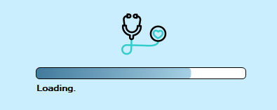
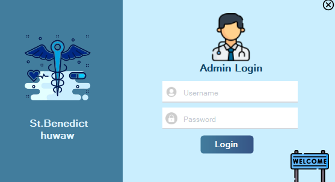
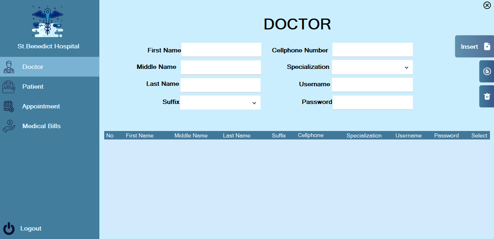
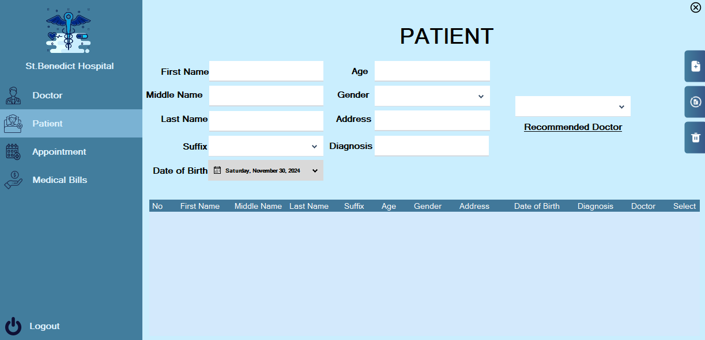
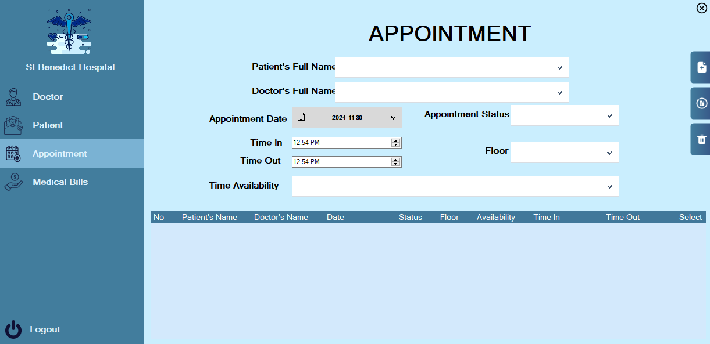
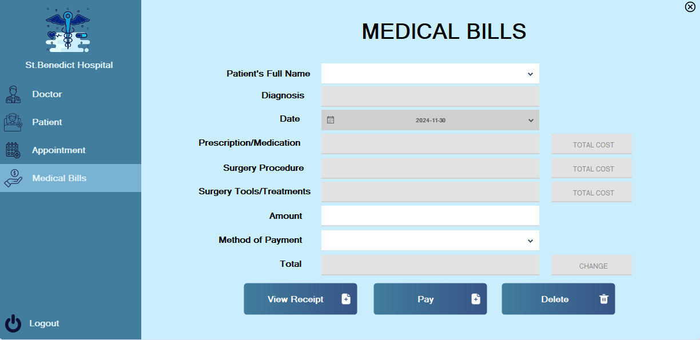

# 🏥 St. Benedict

**Hospital Management System** · `Windows Forms`

Hospital management system for managing doctors, patients, appointments, and medical billing.

## Why This Project

Small clinics often run their front desk on paper ledgers and memory: patient registrations live in notebooks, appointments are jotted on sticky notes, and billing is computed by hand — a process that is slow, error-prone, and impossible to audit after the fact. St. Benedict was built as a school capstone to replace that entire paper trail with a single relational system covering the full patient journey, from intake to paid bill.

The project was developed for a clinic scenario (fictionalized for coursework) as the requirement for a graduating team course. Mark served as the **technical lead of a team of eight**, responsible for the database schema, the shared SQL Server connection layer, the appointment and billing logic, and for reviewing and integrating his teammates' forms into one coherent application. The hardest design problem wasn't any single screen — it was making five modules built by different people behave like one product.

## How It Works

A front-desk clerk, Ana, starts her shift. The loading screen connects to the SQL Server LocalDB while a stethoscope-branded progress bar fills, then the split-layout login appears. She signs in with her front-desk credentials and lands on the front-desk dashboard — the doctor directory loads by default, with sidebar buttons for Patient, Appointment, Medical History, and Medical Bills.

A walk-in, Mr. Reyes, needs a check-up. Ana opens **Patient** and starts typing his diagnosis — "Hyper" — and the autocomplete suggests *Hypertension*. The system immediately surfaces the matching specialty (General Medicine, Cardiology) and filters the doctor dropdown to physicians in those specialties; she picks Dr. Cruz, and his name is saved as Mr. Reyes's recommended doctor along with his demographics.

Ana switches to **Appointment**. She selects Mr. Reyes from the patient dropdown — the form now knows his diagnosis — and the availability dropdown offers only the slots configured for Hypertension (Mon/Wed/Fri 10 AM–12 PM routine check-ups, Wed 1–3 PM chronic illness management). She books Monday morning; the specialty's floor (Floor 1 for General Medicine/Cardiology) is stamped onto the record so Mr. Reyes knows where to go.

After the consultation, the doctor has recorded the visit in Medical History. Ana opens **Billing**: she selects Mr. Reyes, and the system auto-fills his diagnosis, prescription, and procedure from the history record. Costs are not typed — they're looked up: the medication price list prices his prescription, the surgical cost table prices the procedure, and a disease-treatment dictionary sums the tools and consultation fees for his diagnosis. The total is computed automatically. Ana enters the cash tendered, the change is calculated, she hits Pay, and the system saves the payment and generates an A4 PDF receipt — complete with an itemized table and a QR code encoding the receipt number — into the Public Documents folder. The View button reopens that receipt later by patient name.

Behind the scenes, doctors log in with their own credentials and land on a different workspace: they manage their assigned patients, confirm appointments, and write medical-history entries (diagnosis, surgery, prescription, dosage, frequency, notes) that feed straight into billing — no re-entry, no lost forms.

## Modules

### Secure Login & Role Routing
The single entry point authenticates staff against two credential tables — `Login` for doctors and `FrontDesk` for reception staff — and routes each role to its own dashboard, so doctors never see billing controls and clerks never see clinical note fields.

**Scenario:** Dr. Cruz starts her shift and signs in with the credentials Ana's team created when she was registered. Because her account lives in the doctor table, she lands on the Doctor Dashboard with Patient Management, Appointments, and Medical History — never the billing screen.

### Front Desk Dashboard
A sidebar shell that hosts every front-desk module as a docked child form, with active-button highlighting and a logout path back to the login screen. One window, zero popup chaos.

**Scenario:** Ana moves from the Patient form to the Appointment form with a single sidebar click; the current form closes and the next one fills the same panel, keeping her context in one place all morning.

### Doctor Directory
Full CRUD for physicians: name, specialization, cellphone, and login credentials. Insert enforces an 11-digit phone number, rejects duplicate usernames and duplicate name+phone pairs, and creates the linked `Login` row in the same transaction flow.

**Scenario:** The clinic hires a new pediatrician. The administrator fills in her specialty and a username for her account; the system checks that no other doctor has the same name and phone before saving both her profile and her login in one go.

### Patient Intake
Captures demographics and links each patient to a diagnosis and a recommended doctor. A built-in knowledge map of 70+ conditions across General Medicine, Pediatrics, Orthopedics, Cardiology, Dermatology, and Ophthalmology powers the diagnosis autocomplete and drives specialty and doctor suggestions; diagnoses are persisted in a related `PatientDiagnosis` table.

**Scenario:** A mother brings in her child with "Pneumonia." As the clerk types the diagnosis, the form shows Pediatrics as the specialty and filters the doctor list to pediatricians — the clinical routing is decided by the data, not by the clerk's memory.

### Appointment Scheduling
Books patient–doctor appointments against a diagnosis-aware schedule dictionary: each condition maps to specific day/time slots (e.g., routine check-ups Mon/Wed/Fri mornings, chronic illness management Wed afternoons), each specialty maps to a floor, and the appointment date is validated against the doctor's actual availability. Status (pending/confirmed/completed), time-in, and time-out are tracked per booking.

**Scenario:** Ana tries to book a Hypertension patient on a Tuesday morning — the system rejects it and tells her Dr. Cruz is only available during the configured slots, so she rebooks Monday and the patient is sent to Floor 1 with confidence.

### Doctor Workspace
A parallel dashboard for physicians with three focused tools: patient management (their roster), appointment review, and medical-history entry. Doctors record the clinical side of a visit — diagnosis, procedure/surgery, prescription, dosage, frequency, notes — which becomes the single source of truth for billing.

**Scenario:** After examining Mr. Reyes, Dr. Cruz opens Medical History, selects his name, and records the diagnosis, the procedure performed, and the prescription. The next time front desk opens his billing record, everything she typed is already there.

### Medical History
Stores and retrieves the clinical record of each visit — doctor name and role, diagnosis, appointment date, time in/out, surgery, prescription, dosage, frequency, and notes — keyed by patient. Read-only views for verification, and an export path via PDF for records that need to leave the system.

**Scenario:** Three months later Mr. Reyes returns; the clerk pulls up his history and instantly sees his last prescription and procedure without flipping through a paper folder.

### Billing & PDF Receipts
The financial close of every visit. Costs are auto-computed from three dictionaries — medication prices, surgical procedure costs, and per-diagnosis treatment/tool bundles — then summed into a total with change calculation on cash tendered. On payment, the record is saved and an iTextSharp A4 PDF receipt (itemized table, receipt number, date) is written with an embedded QRCoder-generated QR code, and can be reopened later by patient name.

**Scenario:** Mr. Reyes's bill comes to ₱450.00 — a ₱12.00 prescription, a ₱15,000.00 procedure line item where applicable, and consultation and tool fees summed from his diagnosis. He hands over ₱500; the system computes ₱50.00 change, saves the payment, and prints a QR-stamped PDF receipt Ana can re-open with one click.

## Screenshots

### System initialization — the loading screen with stethoscope icon signals medical context while the database connects. Progress bar prevents users from thinking the app has frozen.

### Secure staff access — the split-layout login separates branding (left) from credentials (right). Only authorized hospital staff can access patient records, which is critical for HIPAA-equivalent data privacy.

### Doctor directory management — the form registers new physicians with specialization and login credentials. The empty table indicates no doctors have been added yet; this must be populated before appointments can be scheduled.

### Patient intake — captures demographic and medical information (name, age, diagnosis, DOB) and links each patient to a recommended doctor. This is the entry point for all patient records in the system.

### Appointment scheduler — connects patients with doctors by date, time, and floor. Status tracking (pending/confirmed/completed) lets reception staff manage the daily patient flow efficiently.

### Billing & payment — calculates treatment costs (surgery, prescription, procedure), generates receipts, and processes payments. The Pay/Receipt buttons complete the financial cycle for each patient visit.

## Features

- Admin login with secure authentication
- Doctor registration and management
- Patient registration with diagnosis tracking
- Appointment scheduling with status tracking
- Medical billing with receipts and payment processing

## Tech Stack

- C#
- WinForms
- .NET
- SQL Server

## About

A Windows Forms hospital management application featuring doctor and patient databases, appointment scheduling, and a medical billing system with receipt generation. Built with a clean split-layout login and sidebar navigation.

---

Built by [Mark Crysler Baddo](https://github.com/Kuraisura) · [Portfolio](https://kuraisler.xyz)
